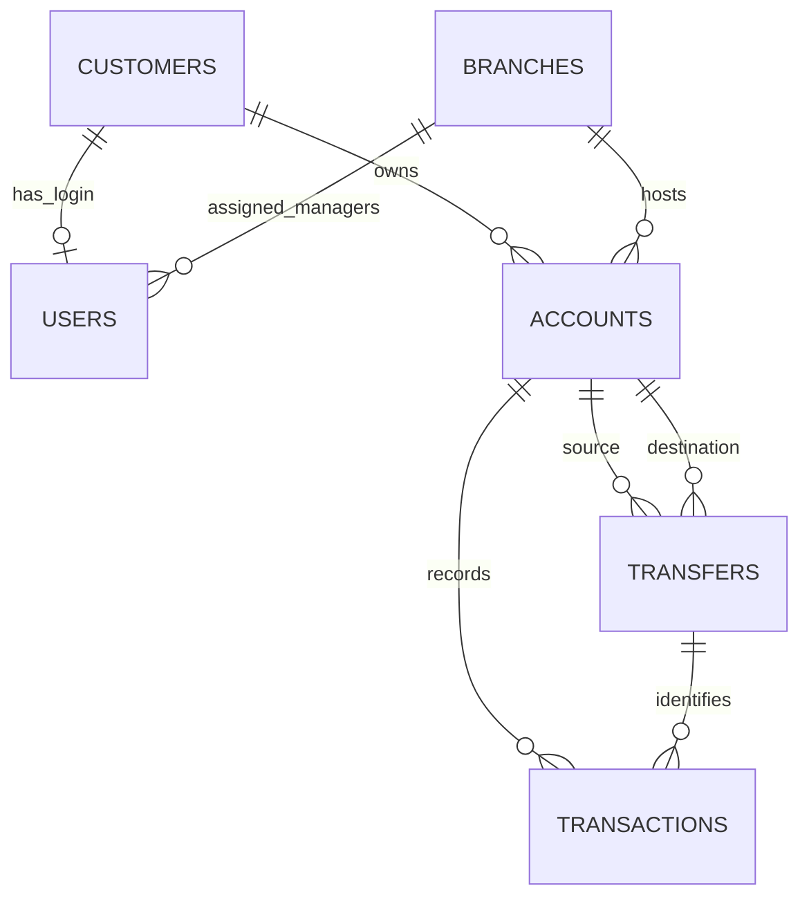

# ER model

Entities are users, customers, branches, accounts, transactions and transfers. A user has either a customer link or a branch assignment, according to its role. Attributes are the columns in `schema.sql`; primary keys identify rows and foreign keys preserve relationships. The account types specialize the general account concept (savings/current). A transfer aggregates its source account, destination account and amount as one business event. Transform each entity to a relation, then represent one-to-many relationships with foreign keys on the many side. MySQL's three-tier view/logical/physical architecture separates application views from the stored schema. Schema is the design; instance is today's data. Logical data independence means changing storage details need not change the API; physical independence means indexes may change without changing the logical schema. DBMS users include application developers, operators, administrators and customers through the UI.
